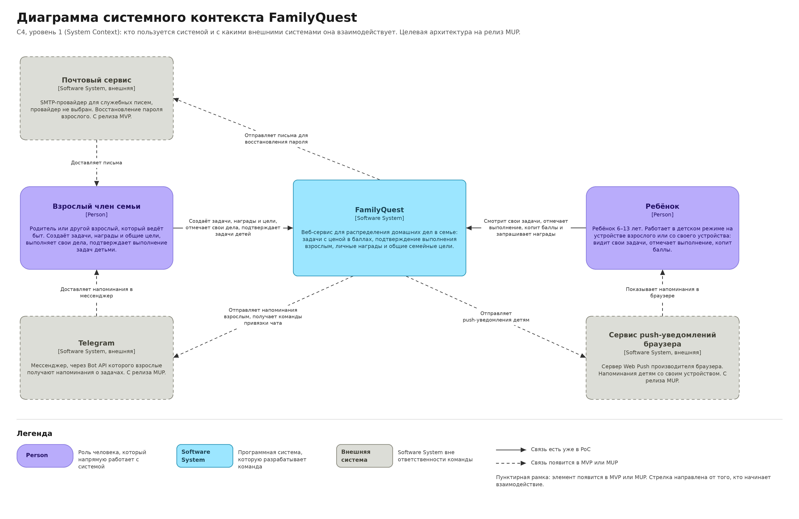
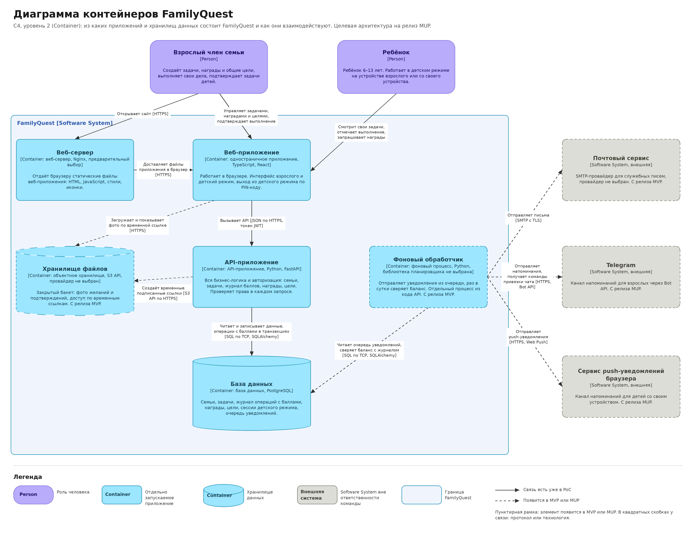

# Архитектура FamilyQuest по модели C4

## Система и её граница

**FamilyQuest** — веб-сервис для распределения домашних дел в семье. Взрослые создают задачи с ценой в баллах, дети и взрослые их выполняют, взрослый подтверждает выполнение задач ребёнка, а баллы копятся на личные награды или на общую семейную цель.

**В ответственность команды входит** всё, что нужно для работы сервиса: веб-приложение в браузере, серверная часть с бизнес-логикой и авторизацией, фоновая обработка, база данных и хранилище файлов, а также их развёртывание.

**Внешние программные системы** — это сервисы других компаний, с которыми FamilyQuest напрямую обменивается данными: почтовый сервис, Telegram и сервисы push-уведомлений браузеров. Хостинг и облачное хранилище не считаются внешними системами: это инфраструктура, на которой работает сам FamilyQuest.

Диаграммы описывают целевую архитектуру на релиз MUP. Элементы, которых ещё нет в PoC и которые появятся в релизах MVP или MUP, обозначены пунктиром. Файлы диаграмм лежат в папке `images` рядом с этим документом. Те же диаграммы есть на доске Miro: https://miro.com/app/board/uXjVHl_s2PY=/?share_link_id=51181680425 . Там их смотреть даже лучше.

## Диаграмма системного контекста FamilyQuest (System Context)

### Элементы

| Имя | Тип | Назначение |
|---|---|---|
| Взрослый член семьи | Person | Родитель или другой взрослый, который ведёт быт. Создаёт задачи, награды и общие цели, выполняет свои дела, подтверждает выполнение задач детьми. Все взрослые в семье имеют равные права. |
| Ребёнок | Person | Ребёнок 6–13 лет. Пользуется сервисом в детском режиме на устройстве взрослого или со своего устройства: видит свои задачи, отмечает выполнение, копит баллы и запрашивает награды. |
| FamilyQuest | Software System | Разрабатываемая система: распределение домашних дел в семье, начисление баллов за выполненные задачи, личные награды и общие цели. |
| Почтовый сервис | Software System, внешняя | SMTP-провайдер для служебных писем, в первую очередь для восстановления пароля взрослого. Появляется в релизе MVP. |
| Telegram | Software System, внешняя | Мессенджер, через Bot API которого взрослые получают напоминания о задачах и о задачах детей, ждущих подтверждения. Появляется в релизе MUP. |
| Сервис push-уведомлений браузера | Software System, внешняя | Сервер Web Push производителя браузера. Канал напоминаний для детей со своим устройством, у которых обычно нет аккаунта в Telegram. Появляется в релизе MUP. |

### Связи

| Откуда | Куда | Взаимодействие | Релиз |
|---|---|---|---|
| Взрослый член семьи | FamilyQuest | Создаёт задачи, награды и цели, отмечает свои дела, подтверждает задачи детей | PoC |
| Ребёнок | FamilyQuest | Смотрит свои задачи, отмечает выполнение, копит баллы и запрашивает награды | PoC |
| FamilyQuest | Почтовый сервис | Отправляет письма для восстановления пароля | MVP |
| FamilyQuest | Telegram | Отправляет напоминания взрослым, получает команды привязки чата | MUP |
| FamilyQuest | Сервис push-уведомлений браузера | Отправляет push-уведомления детям | MUP |
| Почтовый сервис | Взрослый член семьи | Доставляет письма | MVP |
| Telegram | Взрослый член семьи | Доставляет напоминания в мессенджер | MUP |
| Сервис push-уведомлений браузера | Ребёнок | Показывает напоминания в браузере | MUP |

Ребёнок без своего устройства пользуется детским режимом на устройстве взрослого. Для системы это тот же способ взаимодействия, поэтому отдельная связь не показана.

## Диаграмма контейнеров FamilyQuest (Container)

### Контейнеры

| Имя | Тип и технология | Ответственность | Релиз |
|---|---|---|---|
| Веб-сервер | Веб-сервер, Nginx (предварительный выбор) | Отдаёт браузеру статические файлы веб-приложения: HTML, JavaScript, стили и иконки задач. | PoC |
| Веб-приложение | Одностраничное приложение, TypeScript, React | Работает в браузере. Показывает интерфейс взрослого и детский режим. В детском режиме ребёнок видит только свои задачи с крупными иконками, выйти из режима можно только по PIN-коду взрослого. | PoC |
| API-приложение | API-приложение, Python, FastAPI | Вся бизнес-логика: семьи и роли, задачи и их статусы, журнал операций с баллами, награды и общие цели. Здесь же авторизация: API выдаёт токены и в каждом запросе проверяет права, включая ограничения детского режима. | PoC |
| База данных | База данных, PostgreSQL | Хранит пользователей, семьи и роли, задачи, журнал операций с баллами, награды, цели, сессии детского режима и очередь исходящих уведомлений. | PoC |
| Фоновый обработчик | Фоновый процесс, Python (библиотека планировщика не выбрана) | Выполняет то, что не должно задерживать ответ пользователю: отправляет уведомления из очереди в базе и раз в сутки сверяет баланс с журналом операций. | MVP |
| Хранилище файлов | Объектное хранилище с интерфейсом S3 (провайдер не выбран) | Хранит фото желаний из вишлиста и фото подтверждений задач в закрытом бакете. Доступ только по временным ссылкам, фото подтверждений удаляются через 30 дней правилом жизненного цикла бакета. | MVP |

**Почему API-приложение и фоновый обработчик показаны отдельно, хотя это монолит.** Серверная часть FamilyQuest устроена как модульный монолит: один код, разделённый на модули (пользователи, семьи, задачи, журнал баллов, награды, цели). Но фоновый обработчик запускается из этого кода отдельным процессом и работает независимо от API, а в C4 контейнер — это именно отдельно запускаемое приложение. Поэтому на диаграмме два контейнера, а не два сервиса.

**Почему детский режим не отдельный контейнер.** Это режим того же веб-приложения с отдельной сессией и ограниченными правами, а не отдельно запускаемое приложение.

### Связи

| Откуда | Куда | Взаимодействие | Протокол или технология | Релиз |
|---|---|---|---|---|
| Взрослый член семьи | Веб-сервер | Открывает сайт | HTTPS | PoC |
| Взрослый член семьи | Веб-приложение | Управляет задачами, наградами и целями, подтверждает выполнение | — | PoC |
| Ребёнок | Веб-приложение | Смотрит свои задачи, отмечает выполнение, запрашивает награды | — | PoC |
| Веб-сервер | Веб-приложение | Доставляет файлы приложения в браузер | HTTPS | PoC |
| Веб-приложение | API-приложение | Вызывает API: загружает задачи, отмечает и подтверждает выполнение, запрашивает баланс и награды | JSON по HTTPS, токен JWT | PoC |
| API-приложение | База данных | Читает и записывает данные; операции с баллами и постановка уведомлений в очередь выполняются в транзакциях | SQL по TCP, SQLAlchemy | PoC |
| Веб-приложение | Хранилище файлов | Загружает и показывает фото по временной ссылке | HTTPS | MVP |
| API-приложение | Хранилище файлов | Создаёт временные подписанные ссылки на загрузку и просмотр фото | S3 API по HTTPS | MVP |
| Фоновый обработчик | База данных | Читает очередь исходящих уведомлений, сверяет баланс с журналом операций | SQL по TCP, SQLAlchemy | MVP |
| Фоновый обработчик | Почтовый сервис | Отправляет письма для восстановления пароля | SMTP с TLS | MVP |
| Фоновый обработчик | Telegram | Отправляет напоминания, получает команды привязки чата | HTTPS, Bot API | MUP |
| Фоновый обработчик | Сервис push-уведомлений браузера | Отправляет push-уведомления | HTTPS, протокол Web Push | MUP |

Все обращения к внешним системам выполняет фоновый обработчик. API-приложение записывает уведомление в очередь в базе в той же транзакции, что и основное действие, а обработчик забирает его и отправляет. Поэтому сбой почты или Telegram не мешает, например, подтвердить задачу, и уведомление не теряется.

Доставка уведомлений до людей (от почты, Telegram и push-сервиса к пользователям) показана на диаграмме контекста и здесь не повторяется. Балансировщик нагрузки, число экземпляров API и размещение в облаке относятся к уровню развёртывания и на диаграмме контейнеров не показаны.

## Согласованность диаграмм

- Обе диаграммы описывают одну систему, FamilyQuest. Диаграмма контейнеров раскрывает её внутреннее устройство.
- Люди и внешние системы названы на обеих диаграммах одинаково: «Взрослый член семьи», «Ребёнок», «Почтовый сервис», «Telegram», «Сервис push-уведомлений браузера».
- Каждая связь диаграммы контекста раскрывается связями диаграммы контейнеров: например, связь «FamilyQuest отправляет письма в почтовый сервис» на уровне контейнеров выполняет фоновый обработчик.
- На диаграмме контекста нет контейнеров и технологий, на диаграмме контейнеров нет классов, таблиц и других деталей кода.

## Открытые архитектурные вопросы

1. **Хостинг.** Данные пользователей нужно хранить на серверах в России, поэтому рассматриваются российские облачные провайдеры (например, Yandex Cloud или Selectel). Конкретный провайдер не выбран. От этого решения зависит и провайдер объектного хранилища. Нужно решить до релиза MVP.
2. **Провайдер объектного хранилища.** Выбран интерфейс S3, но не провайдер: облачное хранилище выбранного хостинга или MinIO на собственном сервере. Нужно решить до релиза MVP, когда появляются фото желаний.
3. **Почтовый провайдер.** Не выбран SMTP-провайдер для писем восстановления пароля. Нужно решить до релиза MVP.
4. **Вход ребёнка со своего устройства.** В релизе MVP ребёнок сможет входить со своего устройства, но у профиля ребёнка нет почты: это сделано, чтобы собирать минимум персональных данных детей. Не решено, как ребёнок будет входить: по логину и паролю, которые задаёт родитель, по одноразовой ссылке или QR-коду с устройства родителя, или иначе.
5. **Хранение токена авторизации в браузере.** Выбрана авторизация по токенам JWT, но не решено, где их хранить: в cookie, недоступной из JavaScript, или в памяти приложения с передачей в заголовке. От этого зависит защита от разных видов атак (XSS и CSRF). Нужно решить до реализации входа в PoC.
6. **Библиотека для фоновых задач.** Решено, что фоновые задачи выполняются отдельным процессом и берут уведомления из очереди в PostgreSQL, без отдельного брокера сообщений. Конкретная библиотека планировщика не выбрана (рассматривается APScheduler). Нужно решить до релиза MVP.
7. **Веб-сервер для статических файлов.** Предварительно выбран Nginx. Альтернатива: отдавать файлы веб-приложения средствами выбранного хостинга. Решение зависит от выбора хостинга.
8. **Каналы напоминаний.** Предварительно решено: взрослым через Telegram, детям со своим устройством через браузерные push-уведомления. Открытым остаётся вопрос надёжности push-уведомлений на iPhone: в браузере они работают только если сайт добавлен на главный экран. Окончательное решение нужно принять до релиза MUP, где появляются напоминания.
